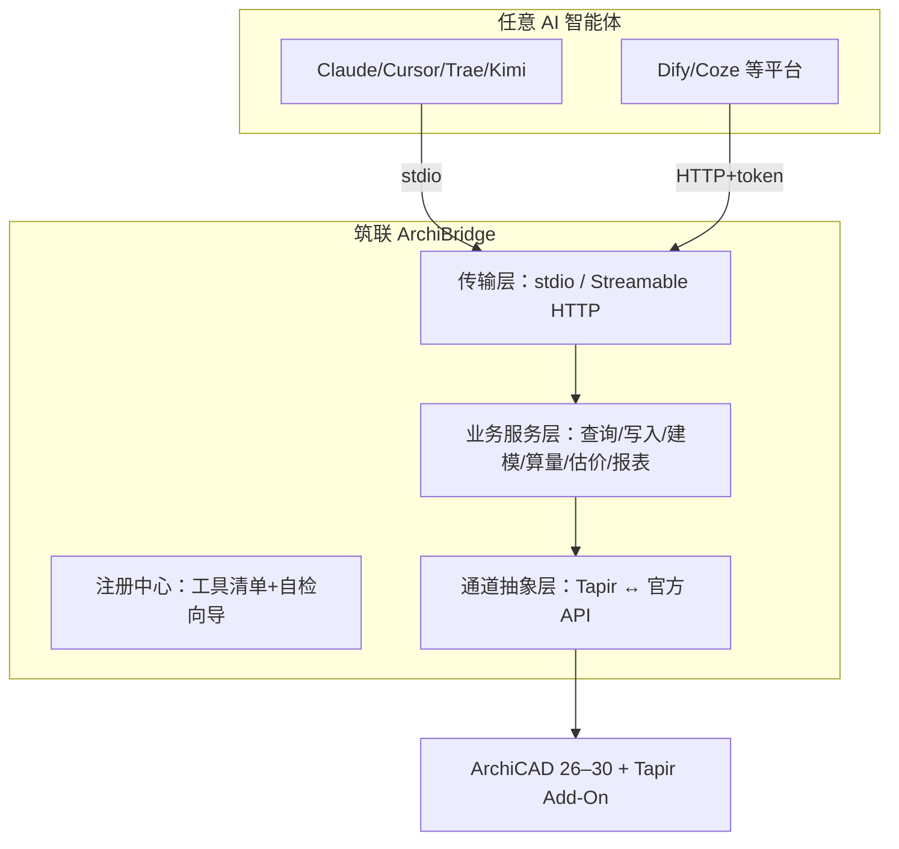

# 筑联（ArchiBridge）调研报告

> AI 智能体 ↔ ArchiCAD 桥梁。让任何支持 MCP 的 AI 客户端（Claude Desktop、Cursor、Trae、Kimi、Codex 等）通过自然语言操作 ArchiCAD。
>
> 调研时间：2026-10-18 · 基于项目 V0.38 现状

---

## 1. 定位

**一句话**：把现有 acmcp（ArchiCAD MCP Server）产品化为「筑联 ArchiBridge」，成为 AI 智能体进入 BIM 世界的标准桥梁。

**目标用户**

| 用户群 | 核心场景 |
|---|---|
| 建筑设计师 | AI 建模/改模、构件查询、图纸核对 |
| 造价工程师 | AI 算量、GB 50500 清单、成本估算 |
| BIM 工程师 | 模型审查、碰撞检测、构件统计 |
| AI 智能体开发者 | 给自己的 Agent 接入 BIM 能力 |

---

## 2. 现有资产盘点（护城河）

| 资产 | 现状 | 可复用性 |
|---|---|---|
| MCP 工具集 | 66 个工具（查询/写入/建模/算量/估价/诊断） | 直接产品化 |
| 算量体系 | 29 模板 + GB 50500 清单编码 + 损耗/公式 | **行业壁垒** |
| 估价体系 | 消耗量表×市场价→人材机→取费，覆盖率透明 | **行业壁垒** |
| 双通道架构 | 官方 Python API（读写属性）+ Tapir（几何/命令） | 稳定运行 |
| 版本兼容 | AC26–29 实测兼容矩阵 + regression.py | 少有同类做到 |
| 安全机制 | 四阶段写入、项目身份强校验、自动撤销 | 企业级卖点 |
| 质量资产 | 537 单测、一键回归、真机验证流程 | 迭代信心 |
| 多实例 | 多版本/多项目并存（ac29-1/ac28-1） | 差异化 |

**结论**：功能面已完整，缺的是「产品化分发」——当前安装需 Python 环境+手动配 Tapir+手写 JSON 配置，门槛过高。

---

## 3. 市场与竞品

| 竞品/参照 | 形态 | 与筑联差异 |
|---|---|---|
| Tapir 官方 | ArchiCAD Add-On（命令层） | 只提供原始命令，无 MCP 封装、无行业工具（算量/估价/清单） |
| Revit MCP（社区开源） | Revit + MCP | 对标 Autodesk 生态，无中文建筑行业规范 |
| Graphisoft 官方 | 截至调研时未见官方 MCP 产品 | 官方入场是最大风险项，需跟踪 |
| 广联达/品茗 AI 功能 | 传统算量软件内嵌 AI | 封闭软件，无法被任意智能体调用 |
| 通用 BIM 查询 MCP | 只读查询为主 | 筑联覆盖「提取→算量→估价→报表」全链路 |

**机会判断**：
- MCP 已成 AI 工具接入事实标准，主流客户端全部支持，无需自建客户端
- 中文建筑行业规范（清单编码/消耗量/取费）是通用工具不具备的深层壁垒
- ArchiCAD 用户基数小于 Revit，但竞争也更少，且 Graphisoft 生态对第三方自动化友好（官方 Python API + Tapir 开源 MIT）

---

## 4. 可行技术路线对比

### 路线 A：本地 stdio MCP Server（现状形态）

```
AI 客户端 ←stdio→ Python Server ←TCP 19723+→ ArchiCAD(+Tapir)
```

- 优点：已实现；低延迟；数据不出本机（安全卖点）
- 缺点：需 Python 3.10+、手动装 Tapir、手改客户端 JSON
- 分发改进（低成本）：发布 PyPI 包 → 用户 `uvx archibridge` 一键启动；启动时自动检测 ArchiCAD/Tapir 并给配置指引

### 路线 B：桌面安装器/打包应用

```
一键安装器（Inno Setup / Tauri 壳）
→ 内置 Python 运行时 + 依赖
→ 自动安装 Tapir .apx 到 ArchiCAD
→ 自动注册 MCP 配置到 Claude/Cursor/Trae 等
```

- 优点：用户门槛降到「双击安装→打开 ArchiCAD→对话」
- 缺点：打包、签名、自动更新的工程量；Windows/macOS 双平台
- 适用：面向非技术用户（设计师/造价员）的规模分发

### 路线 C：容器化 + 远程 MCP（Streamable HTTP）

```
AI 客户端 ←HTTP/SSE→ MCP 网关 → 本机 Bridge Daemon → ArchiCAD
```

- 优点：天然适配多 Agent 平台（Dify/Coze/GPTs 类）；集中鉴权与计费
- 缺点：ArchiCAD 是桌面软件必须跑在用户机器，云端无法直连——需「本地 daemon + 远程网关」混合架构；NAT 穿透、token 管理、安全审计复杂
- 适用：SaaS 化、团队版、按量计费阶段

### 路线 D：ArchiCAD 内嵌插件面板

```
ArchiCAD Python Palette UI → 内嵌 MCP 客户端 → 本地 Server
```

- 优点：体验一体化（不离开 ArchiCAD）
- 缺点：ArchiCAD 内嵌 Python 版本受限；仍需外部 Server；开发量不小
- 适用：长期体验优化，非近期

### 推荐：A → B → C 渐进

| 阶段 | 路线 | 目标 |
|---|---|---|
| 现在 | A（uvx 分发） | 发布 PyPI，一条命令启动，配置自检向导 |
| 短期 | B（安装器） | 覆盖非技术用户；Tapir 自动安装；客户端自动注册 |
| 中期 | C（混合网关） | 服务 Agent 平台与团队；开启 SaaS 可能性 |

**核心理由**：代码资产 100% 复用，只换「壳与分发层」；每阶段都有独立交付价值。

---

## 5. 目标架构（产品化后）



设计原则（延续现有代码）：
- 传输层可插拔（stdio 与 HTTP 共用同一服务层）
- 通道抽象层已就位，未来 ArchiCAD 官方 MCP/API 变化只改一层
- 行业知识（模板/消耗量/价格库）数据化外置，支持用户自定义与共享

---

## 6. 风险与对策

| 风险 | 等级 | 对策 |
|---|---|---|
| Graphisoft 官方出 MCP | 中 | 深耕行业工具层（算量/估价/GB 50500），官方大概率只做通用连接 |
| ArchiCAD 大版本 API 变动 | 中 | 兼容矩阵自动化（已有 regression.py），新版本 2 周内适配 |
| Tapir 项目停滞 | 低 | MIT 开源，最坏情况 fork 自维护；核心命令已封装隔离 |
| 写入操作误伤模型 | 高影响 | 四阶段写入+身份校验已有；产品化再加操作日志回放 |
| 企业数据安全顾虑 | 中 | 主打「本地运行、数据不出机」；HTTP 模式提供本地网关选项 |
| 消耗量/价格库时效性 | 中 | 数据文件外置+版本化，支持用户覆盖与地区系数 |

---

## 7. 结论

- **可行性：高**。技术资产完备（66 工具/537 单测/双版本兼容），缺的只是分发壳，无技术不确定性
- **壁垒：中高**。行业知识库（算量模板/消耗量/清单编码/取费规则）难以短期复制
- **建议**：按 A→B→C 三步走，先以 PyPI + uvx 完成零成本分发，验证真实用户，再投入安装器与网关
