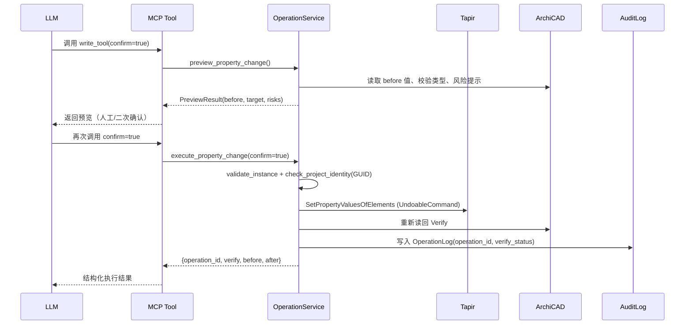

# 知识卡片：ArchiCAD MCP Server V0.28

**卡片编号**：KC-20260928-ARCHICAD-MCP-V0.28  
**核验编号**：VER-20260928-ARCHICAD-MCP-V0.28  
**归档路径**：`E:/啄之堂知识库/02_结构化知识库/BIM/ArchiCAD-MCP/`  
**关联技能**：`bim_engineer`、`cost_code_specialist`、`green_analyst`  
**标签**：#BIM/ArchiCAD #MCP #工程量清单 #GB50500 #自动化建模 #Tapir

---

## 一句话定位
**生产级 ArchiCAD MCP Server**：FastMCP + Tapir Add-On，34 工具、15 类构件建模、四阶段安全写入、GB 50500 清单级算量、双实例 AC28/29 真机验证。

---

## 核心能力矩阵

| 能力域 | 关键指标 | 落地形式 |
|--------|----------|----------|
| **只读查询** | 17 工具（实例/项目/元素/属性/几何/分类/算量） | `read_tools.py` |
| **安全写入** | 8 工具（属性/GDL/分类/建模计划），Preview→Confirm→Execute→Verify | `write_tools.py` + `operation_service.py` |
| **构件修改** | 2 工具，6 类构件几何参数可改 | `modify_tools.py` + `modify_service.py` |
| **构件删除** | 2 工具，全类型支持 | `delete_tools.py` + `delete_service.py` |
| **计划校验** | 1 工具，离线 lint 建模计划 | `plan_tools.py` + `model_plan.py` |
| **运维诊断** | 4 工具（实例刷新/验证/操作状态/审计日志） | `diagnostic_tools.py` + `audit_log.py` |
| **算量引擎** | 16 预设模板、公式/损耗/多量/分类筛选、GB 50500 报表导出 | `aggregate_service.py` + `report_service.py` + `code_table.py` |
| **通道抽象** | 15 类构件创建、7 类修改、删除、存在性查询，可插拔 | `tapir_channel.py` + `channel_base.py` |

---

## 关键技术参数

| 参数 | 值 | 备注 |
|------|-----|------|
| **版本** | V0.28 | 2026-09-27/28 最后修改 |
| **Python** | ≥ 3.10 | |
| **MCP SDK** | `mcp>=1.0.0` | FastMCP |
| **Tapir SDK** | `archicad>=29.3000` | 需 ArchiCAD 安装环境 |
| **ArchiCAD 版本** | AC28 / AC29 | 双实例验证，AC26/27 兼容测试 1 跳过 |
| **工具总数** | 34 | P0只读17 + P1写入8 + 修改2 + 删除2 + 计划1 + 诊断4 |
| **构件类型** | 15 | Wall/Column/Beam/Slab/Door/Window/Stair/Roof/Morph/Mesh/Opening/Zone/MEPRoutingElement/Object/Lamp |
| **算量模板** | 16 | 含混凝土/墙体/楼板/门窗/房间/柱/机电/复合墙分层/幕墙等 |
| **清单编码** | 16 项 | GB 50500-2008 9 位编码 |
| **测试矩阵** | 462/25/12 | 单测/集成/兼容，真机验证 |

---

## 四阶段写入协议（生产级安全基线）



**核心保障**：
- ✅ 项目身份强校验（文件路径 + GUID 存在性）防写错项目
- ✅ `confirm=false` 绝不执行，防误触
- ✅ Tapir 内部 `ACAPI_CallUndoableCommand`，ArchiCAD 中 Ctrl+Z 可撤销
- ✅ Verify 阶段逐元素核对 requested/executed/verified/failed
- ✅ Operation ID 全链路审计，`get_operation_status`/`get_operation_log` 可追溯

---

## GB 50500 算量模板清单（16 个）

| 模板名 | 说明 | 量名 | 分组 | 损耗 | 清单编码 |
|--------|------|------|------|------|----------|
| `concrete_volume` | 混凝土体积：墙/柱/梁/板净体积含 3% 损耗 | `General_NetVolume` | story | 0.03 | ✅ |
| `wall_area` | 墙体表面积 | `General_SurfaceArea` | story | - | ✅ |
| `wall_length` | 墙体 3D 长度 | `General_3DLength` | story | - | ✅ |
| `slab_area` | 楼板净顶面积 | `General_NetTopSurfaceArea` | story | - | ✅ |
| `door_count` | 门窗计数 | `General_3DLength` | type | - | ✅ |
| `zone_area` | 房间计算面积 | `Zone_CalculatedArea` | story | - | ✅ |
| `column_count` | 柱计数 | `General_Height` | story | - | ✅ |
| `mep_length` | 机电管线长度 | `General_3DLength` | type | - | ✅ |
| `wall_summary` | 墙体综合：体积+面积+长度 | 多量 | story | - | - |
| `wall_paint_area` | 墙面涂刷面积（双面） | 公式 `*2` | story | - | - |
| `wall_composite_layers` | 复合墙分层：内饰面/外饰面/核心层 | 多量 | story | - | ✅ |
| `wall_insulation_area` | 墙保温层面积（外饰面） | `Wall_NetOutsideSurfaceArea` | story | - | ✅ |
| `wall_core_volume` | 墙核心层体积（结构层） | 公式减法 | story | - | ✅ |
| `curtain_wall_area` | 幕墙表面积 | `General_SurfaceArea` | story | - | ✅ |
| *自定义模板* | 支持 quantity/quantities/formula + group_by + element_types + waste_factor + with_code | 任意 | 任意 | 任意 | 可选 |
| *模板导出* | `export_table fmt=report` 生成 GB 50500 标准清单报表 | - | - | - | ✅ |

---

## 集成接口契约（给 Orchestrator / 技能封装用）

### MCP 工具调用格式
```json
{
  "tool": "aggregate_by_template",
  "arguments": {
    "template_name": "concrete_volume",
    "instance": "ac29-main"  // 可选，默认首个实例
  }
}
```

### 统一返回结构（`schemas.py:success_result`）
```python
{
  "status": "success",
  "instance": "ac29-main",
  "project": "Florida_K12",
  "count": 4,
  "data": {
    "unit": "m³",
    "groups": [...],
    "flat": [...],
    "template": "concrete_volume",
    "description": "混凝土体积：按楼层汇总墙/柱/梁/板的净体积（含 3% 损耗）"
  }
}
```

### 错误结构（`errors.py:ArchicadMCPError`）
```python
{
  "status": "error",
  "error_code": "INSTANCE_NOT_FOUND|CONFIRM_REQUIRED|CLASSIFICATION_NOT_FOUND|PROPERTY_NOT_FOUND|...",
  "message": "人类可读错误信息",
  "retryable": false,
  "instance": "ac29-main",
  "suggestions": ["可用实例列表", "相似属性名建议"]
}
```

---

## 已知限制与规避

| 限制 | 影响 | 规避方案 |
|------|------|----------|
| 依赖 `archicad` SDK，仅真机可跑 | CI/CD 无法自动化测试 | 专用验证机 + 定时回归 |
| AC28 不支持 `GetElementsByType('All')` | 版本兼容 | `read_tools.py:86-90` 已兜底 `GetAllElements()` |
| 屋顶开洞仅单坡创建时支持 | 修改服务 | 文档标注，复杂屋顶人工处理 |
| 门窗仅支持直墙挂接 | 建模计划 | 曲墙门窗需 GDL 对象替代 |
| Morph 仅方块基础形状 | 任意形状建模 | 复杂形状用 GDL 对象 |
| `door_count` 模板语义不精确 | 门窗计数报表 | 自定义模板用 `count` 聚合 |

---

## 关联文件索引（Obsidian 双向链接）

- [[VER-20260928-ARCHICAD-MCP-V0.28]] 核验确认单
- [[bim_engineer]] BIM Engineer 数字员工技能
- [[cost_code_specialist]] 造价算量专家技能
- [[green_analyst]] 绿建分析师技能（碳排/LCA 需算量输入）
- `E:/啄之堂知识库/02_结构化知识库/BIM/ArchiCAD-MCP/技术规格.md`
- `E:/啄之堂知识库/02_结构化知识库/BIM/ArchiCAD-MCP/工具速查表.md`
- `E:/啄之堂知识库/02_结构化知识库/BIM/ArchiCAD-MCP/算量模板手册.md`

---

## 版本演进记录（摘自 `.operations.jsonl`）

| 版本 | 日期 | 关键变更 |
|------|------|----------|
| V0.28 | 2026-09-27 | 16 算量模板、公式引擎、损耗系数、多量合并、清单报表、15 类构件 |
| V0.27 | 2026-09-26 | 复合墙分层算量修正、核心层体积公式法 |
| V0.10 | 2026-09-25 | `lint_model_plan` 离线校验、识图建模主线起点 |
| V0.07 | 2026-09-24 | 删除工具（preview/delete）、Operation ID 审计 |
| V0.04 | 2026-09-23 | 修改工具（preview/modify）、6 类构件几何修改 |
| V0.03 | 2026-09-22 | 四阶段写入协议定型、项目身份强校验 |
| V0.01 | 2026-09-20 | FastMCP 入口、实例管理、Tapir 通道、基础只读 |

---

**维护责任人**：@curator（知识策展人）+ @techlead（技术实现官）  
**下次更新触发**：V0.29 发布、Tapir SDK 破坏性变更、GB 50500 规范修订、ArchiCAD 30 发布