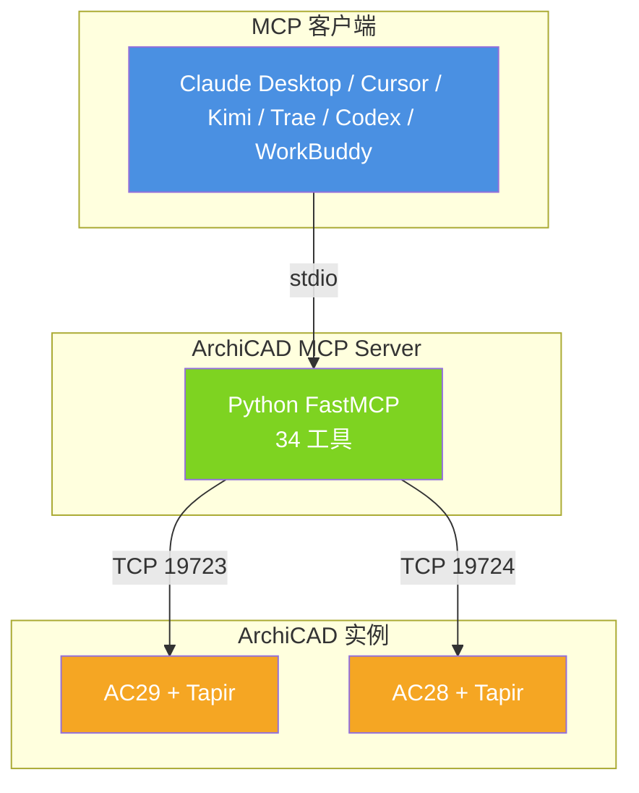

<div align="center">

# ArchiCAD MCP Server

让 LLM 客户端（Claude Desktop、Cursor、Kimi、Trae 等）通过自然语言读取和操作 ArchiCAD 26–29 项目中的 BIM 数据。

[](https://www.python.org/)
[](https://graphisoft.com/)
[](https://modelcontextprotocol.io/)
[](https://github.com/jlowin/fastmcp)
[](https://github.com/ENZYME-APD/tapir-archicad-automation)
[](tests/)
[](#)
[](#)

[核心特性](#核心特性) · [快速开始](#快速开始) · [工具一览](#工具一览) · [配置](#客户端配置) · [版本历史](#版本历史) · [参考文档](#参考文档)

</div>

---

## 目录

- [核心特性](#核心特性)
- [架构](#架构)
- [快速开始](#快速开始)
  - [运行前提](#运行前提)
  - [安装](#安装)
  - [启动](#启动)
  - [AC28 + AC29 双版本并存](#ac28--ac29-双版本并存说明)
- [客户端配置](#客户端配置)
- [沙箱白名单](#沙箱白名单python-site-packages)
- [验证连接](#验证连接)
- [测试与基准](#测试与基准)
- [项目结构](#项目结构)
- [工具一览](#工具一览)
- [图片识别 → 建模计划](#图片识别--建模计划p2-工作流)
- [安全设计](#安全设计)
- [版本历史](#版本历史)
- [实机验证进度](#实机验证进度2026-09-23)
- [参考文档](#参考文档)

---

## 核心特性

| 能力 | 说明 |
|---|---|
| 🛠 **34 个 MCP 工具** | 覆盖只读查询、安全写入、修改、删除、计划辅助、诊断运维 |
| 🏗 **15 类构件建模** | 墙、柱、梁、板、门、窗、楼梯、屋顶、变形体、家具、灯具、网面、洞口、房间区域、机电管线 |
| 📊 **23 个算量模板** | 混凝土体积、墙体分层、幕墙、栏杆、门窗洞口面积、模板估算、外檐真石漆、砌体工程等 |
| 📋 **GB 50500 清单** | 自动映射清单编码、出标准清单报表（xlsx + 标题/项目信息/合计行） |
| 🔒 **四阶段写入** | Preview → Confirm → Execute → Verify，支持 Ctrl+Z 撤销 |
| 🆔 **项目身份强校验** | 写入前核对项目路径 + 元素 GUID，防止项目被切换导致误写 |
| 🧪 **419 单测全过** | 单元 + 集成 + AC26–29 兼容矩阵 + 一键回归脚本 |
| 🖥 **多版本多实例** | 同一套代码兼容 AC26–29，支持双实例并存（ac29-1 / ac28-1） |

---

## 架构



**技术栈**：Python ≥ 3.10 · FastMCP · 官方 `archicad` Python 包 · Tapir Add-On

---

## 快速开始

### 运行前提

1. **ArchiCAD 26–29** 已启动并打开项目（主目标 AC29 build 3000+）
2. 选项 → 工作环境 → 连接端口 已启用
3. **Python ≥ 3.10**
4. 对应版本的 **Tapir Add-On** 已加载
   - 下载：https://github.com/ENZYME-APD/tapir-archicad-automation
   - 通过 选项 → Add-On 管理器 → 添加 加载

### 安装

```bash
pip install -r requirements.txt
# 测试可选
pip install pytest
```

### 启动

```bash
python server.py
```

无 ArchiCAD 实例时 server 仍会启动并打印提示，工具调用时返回结构化错误（`NO_INSTANCE_AVAILABLE`，`retryable=true`），便于 LLM 引导排查。

### AC28 + AC29 双版本并存说明

本项目支持同时连接多个 ArchiCAD 大版本实例。装的是 AC28 和 AC29 时需注意：

- **Tapir Add-On 与大版本一一绑定**：AC29 的 Tapir 不适用于 AC28，反之亦然。必须分别下载 AC28 和 AC29 对应版本的 `.apx`，在各自 ArchiCAD 里通过 `选项 → Add-On 管理器 → 添加` 加载。
- **端口分配**：每个 ArchiCAD 实例占用 19723–19743 中的一个端口。先启动的实例占 19723，第二个占 19724，依此类推。建议先开 AC29 再开 AC28，便于按端口顺序识别。
- **实例 ID 规则**：MCP Server 启动时扫描全部端口，按 `ac + 主版本号 + 序号` 命名，例如 `ac29-1`、`ac28-1`。多实例并存时，所有工具调用须带 `instance` 参数指定目标（仅一个实例时可省略）。
- **客户端切换**：在 Kimi / Trae 里调用 `list_instances` 可看到当前所有实例；调 `project_summary` 等工具时传 `instance="ac29-1"` 或 `instance="ac28-1"`。

---

## 客户端配置

MCP Server 用 stdio 通信，主流客户端配置如下。`server.py` 路径换成你的绝对路径（Windows 用正斜杠或双反斜杠）。

<details>
<summary><b>Claude Desktop / Cursor</b></summary>

配置文件位置：
- Claude Desktop：`%APPDATA%\Claude\claude_desktop_config.json`
- Cursor：设置 → MCP → 新增

```json
{
  "mcpServers": {
    "archicad": {
      "command": "python",
      "args": ["E:/works/Aidev/kbitai绝对安全/kbitai_com_cn/aitools/acmcp/archicad-mcp/server.py"]
    }
  }
}
```
</details>

<details>
<summary><b>Kimi（Kimi-Desktop / Kimi AI 助手）</b></summary>

Kimi 桌面端支持 MCP，在设置 → MCP 服务器中添加，或编辑配置文件：

```json
{
  "mcpServers": {
    "archicad": {
      "command": "python",
      "args": ["E:/works/Aidev/kbitai绝对安全/kbitai_com_cn/aitools/acmcp/archicad-mcp/server.py"]
    }
  }
}
```
</details>

<details>
<summary><b>Trae（Trae CN / Trae IDE）</b></summary>

Trae 在 `设置 → MCP → 添加 MCP Server` 中以表单填写，或直接编辑 `.trae/mcp.json`。项目内已用 Trae 内置变量 `${workspaceFolder}`（启动时自动替换为本机项目根目录），同一份配置 Windows / Mac 通用：

```json
{
  "mcpServers": {
    "archicad": {
      "command": "python",
      "args": ["${workspaceFolder}/archicad-mcp/server.py"]
    }
  }
}
```

Mac 上若提示找不到 `python`，把 `"python"` 改成 `"python3"`（或 Python 完整路径）即可。
</details>

<details>
<summary><b>Codex CLI（OpenAI）</b></summary>

Codex 用 **TOML** 配置（不是 JSON），文件：`C:\Users\<用户名>\.codex\config.toml`。在文件末尾追加：

```toml
[mcp_servers.archicad]
command = "C:/Python314/python.exe"
args = ["E:/works/Aidev/kbitai绝对安全/kbitai_com_cn/aitools/acmcp/archicad-mcp/server.py"]
```

验证：`codex mcp list`（若 `codex` 不在 PATH，用实际安装路径的 codex.exe），看到 archicad 状态 `enabled` 即可。本项目已配置完成。
</details>

<details>
<summary><b>WorkBuddy（腾讯）</b></summary>

WorkBuddy 桌面版读取的用户级配置：`C:\Users\<用户名>\.workbuddy\mcp.json`（注意是 `.workbuddy` 文件夹里、不带点前缀的 `mcp.json`）。

```json
{
  "mcpServers": {
    "archicad": {
      "type": "stdio",
      "command": "C:/Python314/python.exe",
      "args": [
        "E:/works/Aidev/kbitai绝对安全/kbitai_com_cn/aitools/acmcp/archicad-mcp/server.py"
      ]
    }
  }
}
```

**保存后必须手动信任**：打开 WorkBuddy → 连接器管理 → 右上角"自定义连接器" → 找到 archicad → 点"信任"。之后改动 command/args 需重新信任。本项目配置文件已创建，信任步骤需本人操作。
</details>

### ⚠️ 重要：本地 server 限制

本 server 在本机运行、连本机 ArchiCAD，因此：

- **本地客户端可用**：Codex CLI、WorkBuddy 桌面版、TRAE Work/Trae 桌面版
- **纯云端环境连不到本机**：TRAE Work 网页版、WorkBuddy 云端智能体/手机端（WorkBuddy 手机远程指挥时，需电脑桌面端开着做桥接）

---

## 沙箱白名单（Python site-packages）

Trae CN 自带沙箱会拦截对 `C:\Python314\Lib\site-packages` 的写操作，导致跑 `pytest` 时报 `hit restricted`，必须 `dangerouslyDisableSandbox=true` 才能跑。沙箱配置按会话 ID 管理，重启 IDE 后会回到默认白名单（只放行 `docx` 子目录）。

仓库根提供了一键脚本 `enable_pypath_sandbox.ps1`，每次重启 Trae CN 后双击执行即可把 `C:\Python314\Lib\site-packages` 重新注入当前会话的沙箱白名单。脚本是幂等的，已存在会跳过。

```powershell
powershell -ExecutionPolicy Bypass -File .\enable_pypath_sandbox.ps1
```

若以后装了新 Python 版本（如 3.15），把脚本里 `$PySitePackages` 参数改成对应路径再跑：

```powershell
powershell -ExecutionPolicy Bypass -File .\enable_pypath_sandbox.ps1 `
  -PySitePackages "C:\Python315\Lib\site-packages"
```

---

## 验证连接

1. 启动 ArchiCAD 28 / 29 并打开项目，确认 Tapir Add-On 已加载
2. 在客户端里让模型调用 `list_instances`，应返回两个实例
3. 调 `project_summary` 传 `instance="ac29-1"` 看元素总数
4. 已实测：Trae 桌面端自然语言调用成功（2 实例 / 12 墙）

---

## 测试与基准

### 跑测试（在项目根目录）

```powershell
python -m pytest tests/unit/           # 单元测试，无需真机
python -m pytest tests/integration/    # 集成测试，需开 ArchiCAD
python -m pytest tests/compatibility/  # AC 版本兼容矩阵，需真机
python regression.py                   # 一键回归（单测+集成+兼容+基准），--json 存报告
```

无真机时集成/兼容性测试会自动跳过。当前结果（AC28+AC29 真机）：

| 测试类型 | 通过 | 跳过 | 失败 |
|---|---|---|---|
| 单元测试 | 419 | 0 | 0 |
| 集成测试 | 25 | 2 | 0 |
| 兼容性测试 | 12 | 1 | 0 |

### 性能基准

测常用只读命令多次调用的平均/最小/最大耗时（毫秒）：

```powershell
python benchmark.py --instance ac29-1 --rounds 3
```

结果自动存为 `benchmark_results.json` 和 `benchmark_results.md`。真机实测：轻命令 <1–15ms，批量读取（全部元素/属性名/分类）50–70ms，均在百毫秒级，适合对话式调用。

---

## 项目结构

```
archicad-mcp/
├── server.py              # FastMCP 入口：异常包装 + 四层工具注册
├── read_tools.py          # P0 只读工具注册（13 个，从 server.py 拆出）
├── write_tools.py         # P1 安全写入工具注册（8 个，从 server.py 拆出）
├── modify_tools.py        # 构件修改工具注册（2 个，V0.4）
├── delete_tools.py        # 构件删除工具注册（2 个，V0.7）
├── plan_tools.py          # 计划辅助工具注册（1 个，V0.10）
├── diagnostic_tools.py    # P2 诊断工具注册（4 个，从 server.py 拆出）
├── instance_manager.py    # ArchiCAD 实例发现/连接/重连/健康检查
├── tapir_adapter.py       # Tapir 命令统一封装
├── channel_base.py        # 建模通道抽象基类（可插拔通道）
├── tapir_channel.py       # 通道实现：Tapir（15类创建 + 7类修改 + 删除 + 存在性查询）
├── model_plan.py          # 建模计划：数据结构 + 类型注册表（15 类构件）
├── plan_values.py         # 计划基础数值/坐标校验（含 3D 点、3D 洞）
├── plan_framing.py        # 计划校验：墙/柱/梁/板
├── plan_openings.py       # 计划校验：门/窗
├── plan_special.py        # 计划校验：楼梯/屋顶/变形体/网面/洞口/区域/机电管线
├── modify_plan.py         # 构件修改计划：数据结构 + 校验（V0.4）
├── delete_plan.py         # 构件删除计划：GUID 列表校验（V0.7）
├── plan_preview.py        # 建模计划预览（人能看懂的明细）
├── create_service.py      # 建模计划调度：能力闸门/创建/验证
├── modify_service.py      # 修改调度：读当前值/修改/逐字段验证（V0.4）
├── delete_service.py      # 删除调度：预检/删除/details 读回确认（V0.7）
├── query_engine.py        # BIM 条件查询引擎（含分页）
├── property_service.py    # Property 读取/写入与类型校验
├── aggregate_service.py   # 工程量分组汇总（V0.16）
├── code_table.py          # GB 50500 构件类型→清单编码映射（V0.26）
├── report_service.py      # 工程量清单报表排版（V0.26）
├── formula_eval.py        # 算量规则公式安全求值（V0.25）
├── geometry_service.py    # 几何规整：长度/起止点/高程/包围盒
├── benchmark.py           # 性能基准：命令耗时统计（avg/min/max）
├── regression.py          # 一键回归：单测+集成+兼容+基准，汇总报告
├── gdl_service.py         # GDL 参数读写（从 server.py 拆出）
├── operation_service.py   # Preview / Confirm / Execute / Verify 四阶段
├── audit_log.py           # 操作日志（Operation ID）
├── schemas.py             # 输入/输出数据结构
├── errors.py              # 统一异常与错误码
├── requirements.txt
├── debug_log.md           # 变更日志（已满，续记见下）
├── debug_log_2.md         # 变更日志续篇（已满，2026-09-24 起）
├── debug_log_3.md         # 变更日志续篇三（2026-09-27 起）
├── benchmark_results.md   # 性能基准结果（跑 benchmark 自动生成）
├── benchmark_results.json
└── tests/
    ├── unit/              # 单元测试
    ├── integration/       # 集成测试（需真机）
    └── compatibility/     # AC26–29 兼容性测试矩阵
```

---

## 工具一览

### P0 只读工具（16 个）

| 工具 | 说明 |
|---|---|
| `list_instances` | 列出所有 ArchiCAD 实例 |
| `project_summary` | 项目概览（元素数/属性数/楼层） |
| `get_selected_elements` | 获取当前选中元素 |
| `get_elements_by_type` | 按类型取元素 |
| `get_element_properties` | 读元素属性（含 UserDefined） |
| `search_elements_by_criteria` | 条件查询元素 |
| `get_element_geometry_info` | 几何信息（长度/起止点/高程/包围盒） |
| `get_classifications` | 系统分类树 |
| `list_floors` | 楼层列表 |
| `get_gdl_parameters` | GDL 参数读写 |
| `get_element_quantities` | 工程量读取（毛/净体积、表面积、长度等，带单位） |
| `aggregate_quantities` | 按 type/story/属性分组汇总（count/sum/avg，支持分类过滤和 formula 公式） |
| `get_property_definition` | 属性类型/单位/枚举可选项（报错带相近名建议） |
| `list_quantity_templates` | 列出 23 个预设算量模板 |
| `aggregate_by_template` | 按模板名一键算量（含 with_code 时附 GB 50500 清单编码） |
| `aggregate_by_custom_template` | 传 JSON 自定义模板（支持 formula 公式和 with_code） |
| `export_table` | 导出 CSV/Excel/工程量清单报表（支持多表、fmt=report 出 GB 50500 格式） |

### P1 安全写入工具（8 个）

| 工具 | 说明 |
|---|---|
| `preview_property_change` | 预览属性变更（不写入） |
| `set_element_properties` | 设置元素属性（需 confirm=true） |
| `preview_classification` | 预览分类挂接 |
| `attach_classification` | 挂接分类（可撤销） |
| `set_gdl_parameters` | 设置 GDL 参数 |
| `highlight_elements` | 高亮元素 |
| `preview_model_plan` | 预览建模计划 |
| `create_from_plan` | 执行建模计划（需 confirm=true） |

### 构件修改 / 删除 / 计划辅助（5 个）

| 工具 | 说明 |
|---|---|
| `preview_modify_plan` | 预览修改计划（V0.4） |
| `modify_from_plan` | 执行修改（V0.4） |
| `preview_delete_plan` | 预览删除（V0.7） |
| `delete_from_plan` | 执行删除（V0.7） |
| `lint_model_plan` | 离线校验建模计划（V0.10，不连 ArchiCAD） |

### P2 诊断运维（4 个）

| 工具 | 说明 |
|---|---|
| `refresh_instances` | 刷新实例列表 |
| `validate_instance` | 校验实例连接 |
| `get_operation_status` | 查操作状态 |
| `get_operation_log` | 查操作日志 |

> 工具总数：**34 个**

### 已支持建模构件（15 类）

墙 · 柱 · 梁 · 板 · 门 · 窗 · 楼梯 · 屋顶 · 变形体 · 对象（家具）· 灯具 · 网面 · 独立洞口 · 房间区域 · 机电管线（风管/水管/桥架）

### 只读可算量构件（Tapir 不支持创建）

幕墙（CurtainWall）· 栏杆（Railing）· 壳体（Shell）· 天窗（Skylight）——可查询、可取工程量、可分组汇总，但不能通过建模计划创建（Tapir 未实现对应 Create 命令）。

---

## 图片识别 → 建模计划（P2 工作流）

识图由 LLM 客户端完成（把平面图照片/截图发给 Claude/Kimi 等视觉模型），server 负责消化计划。标准流程：

1. **标定比例**：先问用户图上一个已知尺寸（如"这面墙 6 米"），建立像素→米换算；无已知尺寸时先用假设比例并在预览时声明
2. **定原点**：选平面图左下角或某个房间角点为 (0,0)，所有坐标转成相对原点的米制坐标
3. **按序提取**：先墙（起止点），再柱梁板，再门窗（wall 填墙序号），最后楼梯/屋顶/变形体。门窗必须落在某面墙上
4. **lint 自检**：调 `lint_model_plan` 离线校验，按报错修正，直到 ok=true。这步不连 ArchiCAD，可反复迭代
5. **预览确认**：调 `preview_model_plan` 给用户看明细，用户确认后调 `create_from_plan(confirm=true)` 执行

常见坑：坐标别用像素直接填（必须是米）；墙起止点顺序影响门窗 offset 方向；屋顶/板建在非当前楼层会假成功（level 填当前楼层标高）。

---

## 安全设计

- **写操作统一四阶段**：Preview → Confirm → Execute → Verify
- 写入默认 `confirm=false`，需明确 `confirm=true` 才执行
- **项目身份强校验**：discover/refresh 时记录项目文件路径基线；写入前重新核对路径 + 目标元素 GUID 是否仍存在，项目被关闭/另存为/切换时拦截（错误码 `PROJECT_IDENTITY_CHANGED`），调 `refresh_instances` 建立新基线后才能继续
- 写入走 archicad 原生 API（`SetPropertyValuesOfElements`，内部已包 ACAPI_CallUndoableCommand，Ctrl+Z 可撤销）；读操作走 Tapir 通道（Tapir 写命令的参数 schema 与原生不一致，实测会拒绝，见 debug_log.md）
- 构件修改（V0.4）：项目身份与构件存在性分开校验，构件已删除时报直白错误；改后用 GetDetailsOfElements 逐字段读回比对（容差 1 厘米）
- 所有写操作生成唯一 Operation ID 并记录日志

---

## 版本历史

<details>
<summary><b>📜 点击展开完整版本历史（V0.1 → V0.29）</b></summary>

- **V0.1**：架构、P0 只读工具、代码骨架
- **V0.2**：基于官方包与 Tapir 源码查证修订
- **V0.3**：工程化设计（InstanceManager、Query Engine、四阶段写入、结构化返回、Property 类型系统、分页、Operation Log、统一错误码、测试矩阵、Benchmark、GDL Engine 分层）
- **V0.3 实机验证**（2026-09-23）：双版本 AC28+AC29 实测通过，详见「实机验证进度」
- **V0.0**：对话建模第一阶段。建模计划（model_plan）、通道抽象层（channel_base，可插拔，便于将来接入官方 MCP）、Tapir 通道（墙/柱）、预览与创建调度；新增 preview_model_plan / create_from_plan，共 22 工具。AC29 真机闭环通过，单测 182/182
- **V0.1**：建模计划扩展梁、板（默认梁截面 0.2×0.3、板厚 0.2）。复合结构板厚以结构层为准。单测 194
- **V0.2**：门、窗（可挂墙）。门窗的 wall 支持"计划墙序号"或"已有墙 GUID"双引用，调度按"先墙后门窗"两轮创建。门默认 1.0×2.1 门槛 0，窗默认 1.2×1.5 窗台 0.9。AC29 真机关联通过（门窗 ownerElementId 指向新墙），单测 212
- **V0.3**：楼梯（Stair）、屋顶（Roof）、变形体（Morph）。楼梯按基线生成、可选踏步数；屋顶给坡度=单坡（转轴默认多边形第1边，可 pivot 覆盖），不给=多平面；变形体目前只支持方块。屋顶底标高必须填当前楼层（首层 0），否则假成功。楼梯详情 Tapir 暂不支持读取。AC29 真机 3/3，单测 228
- **V0.3.1 重构**：拆 server.py（493→62 行）为纯入口，新增 read_tools.py（P0 10个）、write_tools.py（P1 8个），与已有 diagnostic_tools（P2 4个）统一 register(mcp, safe) 注册模式。工具总数仍 22，单测 228
- **V0.4**：构件修改。新增 modify_plan（修改计划校验）、modify_service（读当前值/修改/读回验证）、modify_tools 两个工具 preview_modify_plan / modify_from_plan。支持墙（端点/高/厚）、柱（平移/高/截面宽深）、门和窗（洞口宽高/窗台）。真机 4 类混合 4/4 改后改回均通过，假 GUID 报"构件不存在"。工具 24 个，单测 265
- **V0.5**：修改扩到梁/板/屋顶 + 变形体任意形状。梁改端点/截面宽高，板改绝对标高/厚，多平面屋顶改厚/檐出（ModifyRoofs 只支持多平面，单坡不在范围）。变形体除方块外可用 body 描述任意形状：vertices（相对基点的 3D 点）+ faces（点序号面）+ solid（实体/曲面）。真机：梁端点/截面、板标高、屋顶檐出、四面体变形体均通过；复合结构构件的 thickness 改不动（读回如实报失败，非 bug）。单测 287
- **V0.6 还债**：清理项目根 21 个历史探查脚本；拆 model_plan（488→139 行）为计划骨架，新增 plan_values（基础数值校验）、plan_framing（墙柱梁板）、plan_openings（门窗）、plan_special（楼梯屋顶变形体）。纯结构整理、无行为变化，24 工具与 287 单测不变
- **V0.7 构件删除**：新增 delete_plan（GUID 列表校验/去重）、delete_service（项目与构件预检→删除→读回确认，最多重试 3 次）、delete_tools 两个工具 preview_delete_plan / delete_from_plan。通道用 Tapir DeleteElements（整批一个 success）。真机：单根/批量均一次成功并确认消失。关键坑：构件删除后 Tapir 仍返回 details 为空的占位项，存在性必须看 details 非空，否则误判。工具 26 个，单测 310
- **V0.8 板/屋顶开洞**：Slab 创建/修改均支持 holes（洞列表，每个洞是多边形顶点，≥3 点）；单坡屋顶创建时支持 holes；多平面屋顶给 holes 计划校验阶段报错（Tapir 会静默忽略）。修改 holes 为全量替换语义。真机 4 项全过：板创建+修改、单坡屋顶创建、多平面拦截。新增洞比对算法（去闭合点+集合容差匹配）。单测 334
- **V0.9 L 形楼梯**：Stair 新增 path 字段（≥2 点折线），支持 L 形/多段基线楼梯；start+end 仍兼容直梯。真机创建成功，数量增减正常。单测 342
- **V0.10 计划辅助**（P2 起点）：新增 plan_tools 与 lint_model_plan 工具——离线校验建模计划（不连 ArchiCAD），返回构件统计或具体字段错误，供识图生成计划后快速迭代。readme 新增「图片识别 → 建模计划」工作流节。工具 27 个，单测 348
- **V0.11 对象/灯具**：建模计划新增 Object（家具）/ Lamp（灯具）两类构件，字段 name（库部件名）+ x/y/z 落点，走既有 lint→预览→创建链路，无新增工具。name 必须与项目已加载库部件名完全一致（中文库如 '沙发 01'），否则报 Not found library part。真机：沙发+餐椅创建/读回/删除还原通过。已补扫出 16 个灯具名（吊灯、壁灯、日光灯、床头灯、聚光灯、日式灯、天花板灯、墙射灯、区域灯光等，见 debug_log_3）。单测 359
- **V0.12 网面/独立洞口**：建模计划新增 Mesh（网面）/ Opening（独立洞口）。Mesh 用 3D 顶点做起伏地形（polygon 各点 z 可不同），支持 3D 洞 holes 与内部等高线 sublines；Opening 在墙/板/梁/网面上开矩形洞（host 给计划序号或已有 GUID + basePoint 基点 + width/height）。真机：墙+板+起伏网面+两个洞口 verify 5/5、删除还原通过。单测 377
- **V0.13 房间区域**：建模计划新增 Zone。两种几何：polygon 手画房间轮廓（≥3 点），或 referencePoint 给房间内一点由 ArchiCAD 按周围墙自动识别；可选 category（类别属性 GUID）、stamp（标签落点）。number 编号缺省按序号。真机：两个房间手动+自动各一个，verify 7/7，自动识别轮廓正确收缩到墙内边，删除还原通过。单测 390
- **V0.14 机电管线**：建模计划新增 MEPRoute，一类覆盖风管（Ventilation）/水管（Piping）/桥架（CableCarrier）。path 给 3D 路径点（≥2），shape 选矩形/圆形/椭圆/槽形，矩形给 width/height，圆形只给 width（直径）。创建走 MEP 专用命令；验证也走 MEP 专用查询（通道 exists 钩子，不经 GetAllElements）。注意：真机发现 MEP 删除行为与普通构件不同（DeleteElements 返回成功但管网图计数不降），完整的删除还原验证待回机前在 3D 界面核对。单测 404
- **V0.15 工程量读取**：新增只读工具 get_element_quantities（工具 28 个）。走 ArchiCAD 内置属性取量（General_GrossVolume/NetVolume/SurfaceArea/3DLength 等，真机枚举验证），默认 14 项通用量，也可传任意 BuiltIn 名（如 Slab_GrossTopSurfaceArea、Zone_CalculatedArea）；每项带单位标注（m/m²/m³/°）。为后续算量功能供原料。单测 407
- **V0.16 工程量汇总**：新增只读工具 aggregate_quantities（工具 29 个）。按维度分组求和（count/sum/avg），维度支持 type/story/任意属性名，自动翻页取全量。例：一句"按楼层汇总墙的净体积"直接出表。单测 414
- **V0.17 算量配套**：属性名解析/类型查询加进程内缓存（批量读量提速）；aggregate_quantities 支持 classification 过滤（按分类项归并）；新增 get_property_definition 工具（30 个）查属性类型/单位/枚举可选项。单测 419
- **V0.18 算量收尾**：aggregate 结果新增 flat 平铺行（直接转表）；属性名报错自动附相近名建议（如 General_GrossArea → General_SurfaceArea）；兼容性矩阵补量属性类型核验与 MEP 命令存在性；新增 regression.py 一键回归（单测+集成+兼容+基准，456 通过 0 失败）
- **V0.19 幕墙只读支持**：确认 Tapir 未实现 CreateCurtainWalls，幕墙（CurtainWall）仅支持查询/工程量/汇总，不支持建模创建。查询与算量走通用 GetElementsByType 接口，无需代码改动，仅文档标注。真机验证：AC29 幕墙表面积读取正常
- **V0.20 栏杆等只读支持**：确认 Tapir 未实现 CreateRailings/CreateShells/CreateSkylights，栏杆/壳体/天窗与幕墙同属只读可算量类型。查询通道真机验证通过（AC28+AC29 返回 0 无报错），算量逻辑与 CurtainWall 一致。项目内无栏杆实例，工程量待有数据时补测
- **V0.21 算量模板+导出**：新增 list_quantity_templates（8 个预设模板：混凝土体积/墙体面积/墙体长度/楼板面积/门窗计数/房间面积/柱计数/机电长度）、aggregate_by_template（按模板名一键算量，多构件类型自动合并）、export_table（算量结果导出 CSV 到 output/ 目录）。工具总数 30→33。真机：wall_length 8.0m、concrete_volume 8.55m³，CSV 导出正常。单测 424 全过
- **V0.22 楼层名+构件名补全**：汇总结果新增 story_name（楼层中文名，如"一层"）、type_name（构件类型中文名，如"墙"）、element_names（构件名列表，如"墙01,外墙01"）。flat_rows 同步带名称，CSV 导出直接可读。真机验证通过
- **V0.23 损耗系数+多量合并**：aggregate() 新增 waste_factor 参数（损耗系数，结果含 sum_with_waste 列）；支持多量合并（quantities 参数 / 模板 quantities 字段，一张表同时出体积+面积+长度）。concrete_volume 模板带 3% 损耗；新增 wall_summary 模板。单测 428 全过
- **V0.24 自定义模板+Excel 导出**：新增 aggregate_by_custom_template 工具（传 JSON 自定义算量模板，含 quantity/quantities/group_by/element_types/waste_factor）；export_table 支持 fmt=xlsx 导出 Excel（表头加粗+列宽自适应）。单测 431 全过。工具 34 个
- **V0.25 算量规则公式+多表导出**：新增 formula_eval.py（ast 安全求值器，支持 + - * / 四则运算）；aggregate() / aggregate_by_template() / aggregate_by_custom_template() 支持 formula 字段（如 `General_NetVolume * 1.03`），比 waste_factor 更灵活；aggregate_quantities 工具加 formula/formula_name 参数；export_table 加 sheets 参数（一次导出多张表到同一 xlsx）。新增 wall_paint_area 模板（表面积*2 公式演示）。单测 444 全过
- **V0.26 GB 50500 清单编码+工程量清单报表**：新增 code_table.py（16 类构件→清单编码映射，如 Wall 010502001/Slab 010505001）；新增 report_service.py（GB 50500 标准清单报表排版：标题/项目信息/表头/数据行/合计）；aggregate() / 模板支持 with_code 参数（True 时按 type 分项，自动附加 code/code_name/code_unit 列）；8 个预设模板启用 with_code；export_table 加 fmt=report 模式（一键出 GB 50500 清单 xlsx）+ value_column/project_name 参数。单测 455 全过
- **V0.27 复合墙分层算量**：调研确认 Tapir/官方 API 无复合结构直接命令，但墙体 BuiltIn 属性已含分层信息。按 GB 50500 清单规则（核心层按体积 m³，饰面/保温层按面积 m²）新增 3 个模板：wall_composite_layers（内/外饰面面积 + 核心层体积，3 量同表，用 Wall_NetInsideSurfaceArea / Wall_NetOutsideSurfaceArea / General_NetVolume）、wall_insulation_area（保温层面积=外饰面面积，因保温层贴外墙外侧）、wall_core_volume（公式法：净体积 - 内层体积 - 外层体积 = 核心结构层体积）。复用 V0.25 formula + V0.26 with_code 现有能力，无需新命令/模块。单测 461 全过
- **V0.28 幕墙专属算量模板**：V0.19 已实现幕墙读取+算量（通用 aggregate 路径，CW002 验证 SurfaceArea=10.0 m²），但缺专属模板。新增 curtain_wall_area 模板（quantity=General_SurfaceArea，element_types=[CurtainWall]，with_code=True 自动附 010805001/幕墙/m²）。幕墙无体积属性（General_GrossVolume=None），仅按面积 m² 算。单测 462 全过
- **V0.29 栏杆专属算量模板**：栏杆与幕墙同属只读可算量构件（V0.20 确认 Tapir 未实现 CreateRailings），新增 railing_length 模板（quantity=General_3DLength，GB 50500 栏杆按 m 计，with_code=True 自动附 010606001/金属栏杆/m）。真机 AC28 验证 rows=[]（项目无栏杆实例），通道正常无报错。单测 463 全过

</details>

---

## 实机验证进度（2026-09-23）

以下全部在真机（AC29 build 5003 + AC28 build 6003 双实例）验证通过：

| 验证项 | 结果 |
|---|---|
| 实例发现（list_instances 双版本） | ✓ ac29-1 + ac28-1 |
| 项目概览（project_summary） | ✓ 8 元素 / 809 属性 |
| 按类型取元素（get_elements_by_type Wall） | ✓ 8 面墙 |
| 属性读取（get_element_properties） | ✓ 含 UserDefined 属性 |
| 预览（preview_property_change） | ✓ 不写入，before/target/risk |
| 确认门禁（confirm=false 拒绝） | ✓ CONFIRM_REQUIRED |
| 完整四阶段写入（confirm=true） | ✓ 8 墙耐火等级"1 小时"→"2小时"，verify 8/8 |
| Operation Log（OP-20260923-00001） | ✓ 自动生成 |
| MCP 协议传输层（stdio 客户端实测） | ✓ initialize / list_tools(20) / call_tool 全通 |
| 分类挂接（preview_classification / attach_classification） | ✓ 挂"标准墙"verify success，可撤销，OP-20260924-00001 |
| 完整几何（get_element_geometry_info） | ✓ 长度 14.15m / 高 3m / 厚 0.3m / 起止点 / 包围盒 |
| 项目身份强校验（check_project_identity） | ✓ 路径一致通过；篡改路径/假 GUID 均拦截 |

MCP 传输层验证方式：`_probe_mcp_client.py`（mcp SDK 客户端，stdio 启动 server.py 子进程，走 initialize → list_tools → call_tool 完整协议）。

剩余可选项：把本 server 接入真实 LLM 客户端（Claude Desktop / Kimi / Trae，配置见「客户端配置」节）。

---

## 参考文档

| 文档 | 链接 |
|---|---|
| ArchiCAD Python API | https://archicadapi.graphisoft.com/Documentation/api/ |
| archicad PyPI | https://pypi.org/project/archicad/ |
| MCP 协议规范 | https://modelcontextprotocol.io/ |
| Tapir Add-On | https://github.com/ENZYME-APD/tapir-archicad-automation |
| Tapir 命令文档 | https://enzyme-apd.github.io/tapir-archicad-automation/ |

---

<div align="center">

[⬆ 回到顶部](#archicad-mcp-server)

</div>
